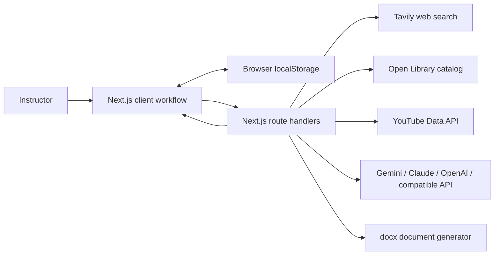

# CourseForge — Project and Interview Guide

This guide describes the implementation in this repository as it exists today. It is designed to help explain the project clearly and answer technical and product questions in an interview. Be precise about the limits of AI-generated content and source evidence; CourseForge assists instructor review and does not certify accuracy.

## 1. Project pitch

**30-second version:** CourseForge is a browser-based lesson-building workspace for instructors. An instructor enters a lesson title and learning objective, then the app researches sources, creates a timed 45-minute lesson draft, runs two separate quality reviews, and exports the finalized lesson and QC reports as Word documents. The app preserves the work in the browser so a reload can resume the workflow. AI and live research are provider-backed, while clearly labeled curated samples and heuristic checks offer a useful demonstration when those providers are unavailable.

**Problem it addresses:** Preparing a lesson means moving between research, instructional planning, quality review, and document preparation. CourseForge puts those steps into one guided workflow and keeps the human instructor in control of edits and final review.

**Who it is for:** Instructors or instructional designers preparing a focused lesson. It is not a learning management system, student-facing course platform, or autonomous fact-checking service.

## 2. User journey

The app uses a five-step workflow. Only the current step is shown, and the user advances explicitly.

1. **Lesson brief:** Enter a title and learning objective. The form validates both fields and stores the brief in browser `localStorage`.
2. **Research:** Build the lesson. Two matching curated examples (HTTP and Git branching) are available without live providers. Other briefs use live web, book-catalog, and YouTube search plus a configured AI provider. A loading state is shown while work runs. On failure, the brief remains saved and can be retried.
3. **Lesson draft:** Review the timed sections, purposes, explanations, examples, applications, knowledge checks, and references. Instructors can make direct edits or ask the configured model to revise one selected section. AI edits appear as a preview; they change the saved lesson only after the instructor applies them.
4. **Quality checks:** Run the two layers separately: Layer 1 for research/source and factual review; Layer 2 for instructional quality and objective alignment. Reports show findings and recommendations. An instructor can open a suggested change as a section-specific prompt. Applying an edit invalidates both prior reports, so the revised draft needs fresh checks.
5. **Final review and export:** Preview the lesson and both completed reports. The server generates separate `.docx` files for the lesson and the QC reports. Downloading either asks whether to download the other too, then shows a completion screen.

Both QC layers must be complete before export. “Complete” means the review ran; it does not mean that the lesson is error-free or objectively verified.

## 3. Architecture at a glance



The browser owns the step-by-step UI and saved draft. Route handlers validate requests and call provider APIs from the server so provider keys are not sent to the browser. The app currently has no user accounts or server-side draft database; saved sessions are local to the browser profile/device.

## 4. Technology stack and why it is used

| Technology | Where | Why it fits |
|---|---|---|
| Next.js 16 App Router | `src/app`, `src/app/api` | One framework provides the UI, route handlers, metadata, and production build. Route handlers keep provider calls server-side. |
| React 19 | `src/app/page.tsx`, `src/components/lesson` | Manages the interactive workflow, draft editor, async loading/error states, and review panels. |
| TypeScript 5 | `src/**/*.ts(x)` | Makes the lesson, source, finding, and report shapes explicit and catches many integration mistakes at build time. |
| Tailwind CSS 4 plus custom CSS | `src/app/globals.css` | Tailwind is installed and imported; the custom CSS contains the branded palette, responsive layout, and detailed component styling. |
| Node.js / native `fetch` | Route handlers and `src/lib` | Calls external search and AI APIs without adding provider SDK dependencies. Request timeouts and HTTP failures are handled at the call sites. |
| `docx` | `src/app/api/lessons/export/route.ts` | Builds real Word `.docx` documents on the server, including headings, references, report findings, and page headers/footers. |
| Tavily Search API | `src/lib/research/live-research.ts` | Retrieves web search results and limited excerpts for the lesson research workflow. |
| Open Library Search API | `src/lib/research/live-research.ts` | Finds book catalog records. It supplies bibliographic metadata, not full-text book evidence. |
| YouTube Data API | `src/lib/research/live-research.ts` | Finds relevant videos and their metadata/descriptions. A video description is not a transcript or independent verification. |
| Gemini, Anthropic Claude, OpenAI, OpenAI-compatible API | `src/lib/ai/model.ts` | Provider adapters allow lesson generation, section editing, and model-assisted QC to use a configured model API. Gemini can retry selected transient/server/rate-limit failures with a fallback model. |
| Browser `localStorage` | `src/app/page.tsx` | Preserves the brief, lesson, workflow step, and download completion state across reloads without requiring accounts or a database. |
| Geist via `next/font/google` | `src/app/layout.tsx` | Provides the app’s bundled font setup and consistent typography. |

The exact configured provider/model comes from environment variable *names* and server configuration. Never include secret values in a README, interview document, browser bundle, screenshot, or Git history.

## 5. Code map: where work happens

### App and interface

- `src/app/page.tsx` — Main client workflow. Owns the current step, brief, current draft, loading/error state, resume behavior, and completion screen.
- `src/components/lesson/lesson-brief-form.tsx` — Brief form and sample topic selection.
- `src/components/lesson/lesson-draft-view.tsx` — Draft rendering/editing, section-specific AI edit preview/apply, quality view, and export controls.
- `src/components/lesson/quality-review-panel.tsx` — Separate Layer 1/Layer 2 controls, findings, recommendations, status, and retry behavior.
- `src/app/globals.css` — Responsive visual styles, theme, layout, controls, cards, status states, and focus treatment.
- `src/app/layout.tsx` — Root document, font, title/description, and social/search preview metadata.
- `design-system/courseforge/MASTER.md` — Brand and design tokens. The palette centers on dark green `#09251C`, ochre `#A55704`, peach `#F3D2AF`, and warm light `#F8EADC`.
- `public/courseforge-mark.svg`, `src/app/icon.svg`, `src/app/apple-icon.png` — Mark-only brand graphic and app icons; the wordmark “CourseForge” is rendered beside the graphic in the UI.

### Server endpoints

- `src/app/api/lessons/route.ts` — `GET` returns live-research readiness; `POST` validates the brief, returns a matching curated sample if applicable, otherwise builds a live researched lesson.
- `src/app/api/lessons/qc/route.ts` — Validates a QC request, then chooses the AI review when eligible or heuristic review as the available fallback (or when explicitly requested).
- `src/app/api/lessons/edit-section/route.ts` — Accepts one section ID and instructor instruction, sends only that section and linked source context for a replacement preview, and returns the preview without mutating the saved lesson.
- `src/app/api/lessons/export/route.ts` — Requires both completed reports, then returns either the lesson document or the reports document as a Word file.

### Domain and provider logic

- `src/lib/lesson/types.ts` — Shared TypeScript domain types for briefs, sources, claims, sections, lesson drafts, and QC reports.
- `src/lib/lesson/brief.ts` — Brief validation and sample briefs.
- `src/lib/lesson/build-http-sample.ts`, `src/lib/lesson/build-git-sample.ts` — Curated prewritten demo lessons with fixed content and references.
- `src/lib/lesson/quality-review.ts` — Deterministic structural/source-metadata checks. It explicitly is not an AI fact checker.
- `src/lib/lesson/ai-review.ts` — Determines when model-assisted review has enough input and sends the lesson/relevant evidence to the model.
- `src/lib/ai/model.ts` — Provider configuration, API requests, timeouts, error translation, structured JSON parsing, and Gemini fallback.
- `src/lib/research/live-research.ts` — External searches, source normalization, evidence excerpts, draft generation prompt/output validation, and provider readiness.
- `src/lib/lesson/markdown-export.ts` — Markdown formatting helper; the current visible final export flow uses Word documents.

## 6. Lesson and source data model

A `LessonDraft` has an ID, a `LessonBrief`, generation method/model metadata, a fixed target duration of 45 minutes, ordered sections, a source library, two QC reports, and timestamps. Sections include a heading, purpose, duration, content, linked source IDs, and optional claim records. Sources identify one of `book`, `website`, or `youtube` and can contain a title, URL, publisher, retrieval date, relevance note, and (for web pages) a bounded excerpt.

The live generation path validates the model response before accepting it. The generated outline must meet its required structure, include the labeled teaching components/answer key, use the planned total duration, and link source IDs from the retrieved source set. The model is not allowed to invent URLs or source IDs. Curated sample lessons follow their own deterministic code path and should be described as samples, not live-researched AI outputs.

## 7. Research and AI: accurate claims to make

### Research source handling

- **Websites:** Tavily returns search results and excerpts. CourseForge filters out non-HTTPS and configured low-signal social domains, records the publisher host and retrieval time, and stores a bounded excerpt. It does not crawl and independently audit every full page.
- **Books:** Open Library provides catalog matches and book metadata. The catalog result is not the full text of a book and does not prove the lesson claims.
- **Videos:** YouTube Data API provides video metadata and descriptions. The app does not treat that as a transcript or as proof of claims.
- A source being listed means it was retrieved as a potentially relevant reference. It does not mean it has been read in full, judged authoritative, or verified against every claim. The interface tells instructors to inspect sources.

### AI provider behavior

`src/lib/ai/model.ts` supports `gemini`, `anthropic`, `openai`, and `openai-compatible`. `AI_PROVIDER` can select a provider; when unset, the implementation detects configured credentials in a defined order. A compatible service also needs a base URL and model. Model calls request structured JSON and parse it on the server. Provider/network/empty-response/invalid-JSON failures return errors while the browser retains the brief and saved draft.

For Gemini, selected transient failures (network, rate limit, or server errors) retry using a configured fallback model or the default fallback. This is a single fallback attempt, not an unlimited retry system. Other provider calls report failures and leave the saved work intact.

Do not claim “works with any AI API key.” It works with the supported provider APIs or an OpenAI Chat Completions-compatible endpoint configured with the needed URL/model/key. Arbitrary APIs and the Codex desktop product are not automatically supported.

## 8. Quality control layers

| Layer | What it reviews | What it cannot prove |
|---|---|---|
| **1 — Research and factual accuracy** | With eligible excerpts, model-assisted review can compare lesson claims against the available website excerpts and references. The heuristic path checks citation links, metadata, source mappings, and related structure. | It cannot prove a claim true, guarantee that an excerpt is complete/current, or inspect full book text/video transcripts. A heuristic report is not factual verification. |
| **2 — Instructional quality** | Reviews objective alignment, clarity, sequencing, examples, practical application, knowledge checks, and pacing. Structural heuristics cover required fields and simple wording patterns. | It cannot know the learners, classroom context, teaching effectiveness, or whether the lesson achieves learning outcomes. |

Reports include method (model-assisted or heuristic), findings, severity, explanation, recommendation, and optional proposed section edit. Scores are not used as proof. Instructors decide what to change and rerun both layers after applying edits.

## 9. Persistence, validation, and errors

- `localStorage` saves the brief, draft (including manual edits and reports), current step, and downloaded-file completion state. On reload, the app restores a matching draft and step. If research was interrupted on the research step, it asks the user to retry.
- This persistence is limited to the same browser profile/device. It is not encrypted cloud storage, account sync, or backup. Clearing browser storage removes it.
- Brief, route payload, section ID, edit instruction, QC layer, and export kind are validated on the server. The section prompt has a 1,200-character limit.
- External requests use timeouts and return actionable errors. The browser keeps saved work so a user can retry. Export rejects a request until both QC layers have completed.
- Applying an AI edit is an explicit instructor action. Applying a manual edit or AI revision resets QC reports to pending, preventing stale QC from authorizing export.

## 10. Word exports

The server uses the `docx` library to create two independent `.docx` files:

- **Lesson document:** objective, planned duration, timed sections, purpose, lesson content, and references.
- **Quality reports document:** lesson context, both reports with method/status/findings/recommendations, and a reference register.

The endpoint returns a Word MIME type and attachment filename. It does not export PDF in the current workflow. Export is available after both QC reports are complete, even when a report contains findings; the instructor remains responsible for deciding whether the lesson is ready.

## 11. Product and design choices

- The interface is a focused instructor workspace rather than a marketing site or large course platform.
- The workflow hides later steps until the instructor advances and requires completion of both QC layers before export.
- CourseForge branding replaced the original project-specific name. The mark is shown with a text wordmark.
- The current theme uses a dark green workspace with warm peach/light surfaces and the palette above. The responsive layout preserves a focused, readable lesson review experience.
- Direct editing and AI revision both preserve instructor control. AI output is shown as a preview and must be applied explicitly.

## 12. Verification and development commands

Available package scripts:

```bash
npm run dev
npm run lint
npm run build
```

TypeScript can also be checked with `npx tsc --noEmit`. A successful production build checks compilation, route bundling, and static generation, but is not a substitute for end-to-end browser tests against live providers. Provider-backed flows also depend on valid keys, quotas, network access, and model availability. Do not claim a complete automated E2E suite unless one has subsequently been added and run.

## 13. Known limitations and sensible next steps

- Draft persistence is browser-local and has no user accounts, cloud database, cross-device sync, or team collaboration.
- Research excerpts and catalog/video metadata are partial. There is no book full-text retrieval or YouTube transcript ingestion.
- Model output and AI reviews can be wrong. Human source inspection is required.
- Search and model providers can be unavailable, rate-limited, or change their APIs/models.
- Curated samples cover only selected matching topics; they are not arbitrary-topic generation.
- Heuristic QC uses transparent rules and simple structure checks; it does not assess nuanced pedagogy or establish factual truth.
- Future work could add authenticated server persistence, source-page retrieval and provenance, transcript/full-text integrations with rights-aware access, broader automated route/component tests, and richer accessibility/usability evaluation.

## 14. Likely interview questions and answer outlines

### Product and architecture

**What does CourseForge do?**  
It guides an instructor from a lesson objective through research, a timed draft, two separate reviews, and Word exports. The instructor reviews and controls edits and final readiness.

**Why build it as a five-step workflow?**  
The steps match the instructor’s decisions and keep the current task clear. It also prevents skipping QC and keeps export gated until both checks have run.

**Why Next.js?**  
The project needs an interactive React UI plus server endpoints for provider keys, research, model calls, validation, and document generation. App Router route handlers let those pieces live in the same TypeScript application.

**Why are API calls made on the server?**  
Search and AI credentials should not be exposed in browser code. Server routes also centralize request validation, timeouts, provider errors, and export rules.

**Why use TypeScript?**  
The app passes structured lesson, source, section, and report objects across UI, API, AI, and export layers. Shared types make those contracts explicit and catch mismatches during compilation.

### Research and AI

**How do you prevent made-up sources?**  
The lesson generator receives retrieved source records and is instructed to reference only supplied IDs/URLs. The response is parsed and validated. That reduces fabricated references but does not prove that each source supports every sentence, so the instructor must inspect the source.

**Are the facts verified?**  
No automatic system can claim that here. Model-assisted Layer 1 compares claims with the available excerpts; heuristic Layer 1 checks source structure and metadata. Neither establishes truth. Book results are catalog entries and video descriptions are not transcripts.

**Why have two QC layers?**  
Research traceability/factual review and instructional quality are different questions. Separating them makes the method and findings clearer and allows each to be rerun independently.

**Does “QC complete” mean the lesson passed?**  
No. It means that review ran and a report is available. There can still be findings, and instructors must assess the content.

**How does provider flexibility work?**  
An adapter selects Gemini, Anthropic, OpenAI, or an OpenAI-compatible chat-completions endpoint. Each adapter translates the request/response format into the app’s common structured JSON result. It is not arbitrary-provider support.

**How are model failures handled?**  
Requests have timeouts and structured errors. Gemini retries certain transient failures once with a fallback model. The browser keeps the brief and saved draft so users can retry without losing work.

### State, security, and quality

**Why localStorage instead of a database?**  
It enabled reload recovery without building user accounts or a backend persistence layer for a focused prototype. Its tradeoff is that data stays in that browser profile and does not sync or back up.

**How do you protect API keys?**  
Provider requests run in server route handlers and read server environment variables; keys are not returned to the client. Keys should never be committed, included in client variables, or pasted into documentation. If a key has been exposed in a Git repository, rotate it and clean Git history as needed.

**How do edits affect QC?**  
The model returns a preview for one section. Applying it changes the draft and resets both reports to pending because the prior reviews describe the older content. Export remains disabled until both are rerun.

**How do you make the 45-minute target reliable?**  
The draft schema has a target duration and the generation path validates section timing against the target before returning it. It is a planned instructional timing, not a guarantee of every class’s actual duration.

**How did you handle request validation?**  
Route handlers parse JSON safely, verify required object/array/string fields, validate the brief and QC layer, check that a section belongs to the lesson, constrain prompt length, and reject incomplete export requests.

### Testing and tradeoffs

**How did you test it?**  
Use lint, TypeScript checking, and the production build for static/code-level verification. Then manually exercise both curated samples, a provider-backed brief, each QC method, edit/apply/rerun, reload recovery, and both exports. Be explicit about which checks you actually ran for the submitted version; do not imply automated E2E coverage if none exists.

**What was a difficult engineering decision?**  
Keeping AI assistance honest while making the workflow useful: sources are surfaced with limitations, AI review is distinguished from heuristic review, edits require approval, and changed content invalidates previous QC.

**What would you improve next?**  
Add persistent user accounts and encrypted server-side drafts, stronger source provenance/full-content inspection where permitted, automated end-to-end coverage, and better classroom-specific instructional review—while preserving the instructor’s final decision.

**What is the biggest limitation?**  
The product can organize research and review, but it cannot independently certify truth or pedagogy. Its evidence is partial and its generated content needs instructor judgment.

## 15. Interview honesty checklist

- Say “model-assisted review,” not “AI verified the facts.”
- Say “Open Library catalog records,” not “full book research.”
- Say “YouTube metadata/descriptions,” not “video transcript analysis.”
- Say “OpenAI-compatible endpoint,” not “any AI API.”
- Say “local browser persistence,” not “cloud-saved account.”
- Say “both reports completed,” not “the lesson passed QC.”
- Distinguish live AI-generated lessons from curated demo lessons.
- State which tests you actually ran and what they cover.

## 16. Suggested short demo narration

“I enter the lesson outcome first. CourseForge then retrieves candidate web, book-catalog, and YouTube references and prepares a timed draft. I review the sections and can ask the model to revise one specific section, but I apply its preview myself. Next I run the research/factual layer and the instructional layer separately. If I change content, the reports are invalidated and must be rerun. Once both reports are complete, I export the lesson and the audit reports as separate Word documents. The app saves the draft in this browser, and the reports clearly distinguish model-assisted review from heuristic checks.”
